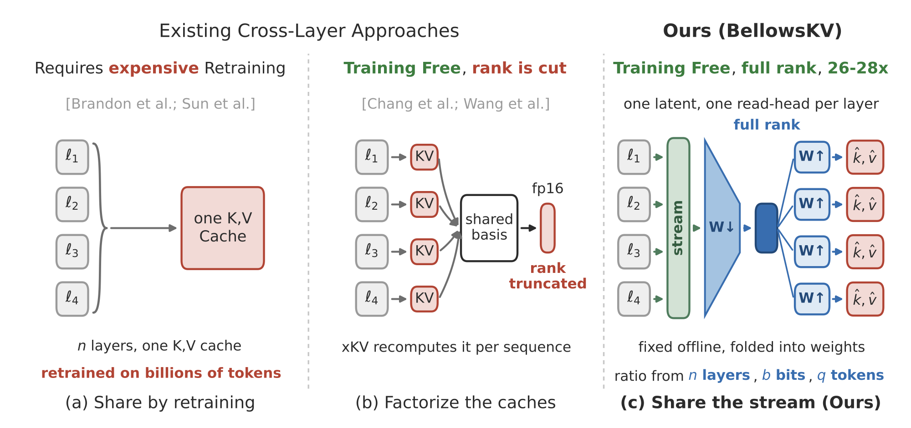

<div align="center">

# BellowsKV

**One latent for many layers, expanded on demand.**

Training-free cross-layer KV-cache compression for 🤗 Transformers and vLLM.

[](https://arxiv.org/abs/2610.35023)
[](#serving-with-vllm)
[](#huggingface-transformers)
[](#installation)

[Paper](https://arxiv.org/abs/2610.35023) · [Quick start](#quick-start) · [Serving with vLLM](#serving-with-vllm) · [How it works](#how-it-works) · [Results](#results) · [TODO](#todo) · [Citation](#citation)

</div>

---

Every layer of an LLM keeps its own key–value cache and re-reads it at every decoding step, so KV-cache memory is
often what limits how many requests a GPU can serve. Neighbouring layers' keys and values are quite different, but
the hidden states that produce them are nearly the same. **BellowsKV** therefore maps the hidden states of
*n* = 4 neighbouring layers to **one shared latent per token**, and each layer reads its own keys and values back
through a fixed, layer-specific projection. The projections come from a closed-form fit on one short calibration
pass. Nothing is trained, and the model's weights are not changed.

<p align="center">
  
</p>
<p align="center"><sub>(c) is BellowsKV. The 26–28× in the figure is the paper's highest-ratio configuration
(BellowsKV-Quant + BellowsKV-Evict). This release ships BellowsKV-A at 8.6×; the other configurations are on the
<a href="#todo">TODO list</a>.</sub></p>

## News

- **2026-11** — v0.1: BellowsKV-A for 🤗 Transformers and vLLM 0.29.

## What v0.1 ships: BellowsKV-A

BellowsKV-A is the configuration of BellowsKV built for serving. The key read-head is constrained to commute with
RoPE, so attention at decode is computed directly on the compressed cache and nothing is reconstructed.

- **8.6× smaller KV cache.** On Llama-3.1-8B, one token in one group of 4 layers takes 1,904 bytes instead of
  16,384 (an INT4 key latent of width 2,560 and an INT4 value latent of width 1,024, with an fp16 scale and zero
  per 128 channels).
- **About 99% of dense accuracy.** 99.2% of the dense average on the paper's 8-task LongBench suite, and the
  same on our re-run of four of those tasks with this package ([Results](#results)).
- **8.6× the sequences at about dense throughput.** At equal GPU memory it holds 190 sequences of 32k tokens
  where the dense cache holds 22, at 0.94–0.97× dense decode throughput (one H200).
- **No training and nothing to download.** The codec is fitted when the model loads, in about 70 s for an 8B model
  on one H100, and cached on disk.
- **Drop-in.** In 🤗 Transformers, call `bellowskv.enable(model, tokenizer)` and `model.generate` works unchanged.
  In vLLM 0.29 it runs as an out-of-tree plugin (no fork), with a paged compressed cache and CUDA graphs for decode.

**Relation to the paper.** BellowsKV-A uses the paper's calibration, joint regression and shared INT4 latent. Its
decode path differs:
- **The paper's shipped decode path** (Appendix B.7, "Mode A") absorbs the value read-head into attention but
  still reconstructs every key at read time.
- **BellowsKV-A absorbs the keys too.** Its key read-head is fitted to commute with RoPE and made wider
  (R<sub>K</sub> = 2.5 d<sub>kv</sub>) to pay for that constraint.

Attention then reads both latents directly at INT4. This is the case the paper's B.7 points to: absorbing keys pays
off only when the cache is read in a sub-fp16 format. The paper's highest-ratio codecs are on the
[TODO list](#todo).

## Installation

```bash
git clone https://github.com/MorrisZJ/BellowsKV.git
cd BellowsKV
pip install -e .
pip install vllm==0.29.0      # optional, only for serving
```

You need an NVIDIA GPU (tested on H100 and H200), Python ≥ 3.10, PyTorch ≥ 2.5, Triton ≥ 3.0 and
transformers ≥ 5.0.

## Quick start

### HuggingFace Transformers

```python
import torch, bellowskv
from transformers import AutoModelForCausalLM, AutoTokenizer

name = "meta-llama/Llama-3.1-8B-Instruct"
tok = AutoTokenizer.from_pretrained(name)
model = AutoModelForCausalLM.from_pretrained(name, dtype=torch.float16).cuda()

bellowskv.enable(model, tok)   # first call fits the codec (~1 min) and caches it; later calls load it

messages = [{"role": "user", "content": "Summarize the following report: ..."}]
inputs = tok.apply_chat_template(messages, add_generation_prompt=True,
                                 return_tensors="pt", return_dict=True).to("cuda")
out = model.generate(**inputs, max_new_tokens=256)
print(tok.decode(out[0, inputs["input_ids"].shape[1]:], skip_special_tokens=True))

bellowskv.disable(model)       # back to the stock dense cache
```

`enable` runs one forward pass over 32 windows of 2,048 tokens (half WikiText-2, half Python source), then solves
one regression per group of layers. The fitted factors are written to `~/.cache/bellowskv` (set `BELLOWSKV_CACHE`
to change this) and reused on every later load.

**Demo: a passcode hidden in a 32k-token document.**

```bash
python examples/hf_demo.py --context 32000 --compare-dense
```

```text
prompt: 32042 tokens, needle at 50%
[dense] answer: '48213'
[bellowskv] BellowsKV-A on: 8 groups of 4 layers, R_K=2560, R_V=1024, INT4, sink 4 + recent 64 exact, 8.61x on the compressed tokens
[BellowsKV-A] answer: '48213'
[BellowsKV-A] KV cache: 0.50 GiB held (latents 0.46 + exact windows 0.04) vs 3.91 GiB dense fp16 -> 7.8x smaller at 32044 tokens
```

(Llama-3.1-8B-Instruct on one H100. The overall ratio is 7.8× rather than 8.6× because the first 4 and the
latest 64 tokens stay exact.)

### Serving with vLLM

The plugin registers itself through vLLM's plugin entry point when `BELLOWSKV_VLLM=1` is set. A stock checkpoint
loads unchanged.

```bash
BELLOWSKV_VLLM=1 vllm serve meta-llama/Llama-3.1-8B-Instruct \
    --dtype float16 --no-enable-prefix-caching
```

```python
from openai import OpenAI

client = OpenAI(base_url="http://localhost:8000/v1", api_key="EMPTY")
reply = client.chat.completions.create(
    model="meta-llama/Llama-3.1-8B-Instruct",
    messages=[{"role": "user", "content": "Summarize the following report: ..."}],
    max_tokens=256,
)
print(reply.choices[0].message.content)
```

Or offline:

```python
import os
os.environ["BELLOWSKV_VLLM"] = "1"          # set before vLLM starts its engine processes

from vllm import LLM, SamplingParams

llm = LLM("meta-llama/Llama-3.1-8B-Instruct", dtype="float16", enable_prefix_caching=False)
print(llm.generate(["The capital of France is"], SamplingParams(max_tokens=32))[0].outputs[0].text)
```

The plugin uses the same factor cache as the 🤗 Transformers package. If no factor file exists for the model, it
fits one on first launch. During that fit a second fp16 copy of the model sits on the GPU (about 16 GB for 8B).
To avoid that, run `bellowskv.enable` once in 🤗 Transformers beforehand: it writes the same file.

The default vLLM compilation settings work (torch.compile with piecewise and full CUDA graphs). Decode runs as
one full CUDA graph and gives the same tokens as eager mode.

### Settings

| Environment variable | Default | Meaning |
|---|---|---|
| `BELLOWSKV_CACHE` | `~/.cache/bellowskv` | where fitted factors are stored |
| `BELLOWSKV_VLLM` | `0` | `1` turns the vLLM plugin on |
| `BELLOWSKV_FACTORS` | — | load this factor file instead of looking it up in the cache (vLLM) |
| `BELLOWSKV_W` | `64` | recent tokens kept exact (vLLM) |
| `BELLOWSKV_SINK` | `4` | first tokens kept exact (vLLM) |

In 🤗 Transformers the same knobs are fields of `bellowskv.BellowsConfig`, passed as
`bellowskv.enable(model, tok, config=BellowsConfig(...))`. The defaults are the BellowsKV-A operating point measured below,
with one runtime addition. Generated tokens move into the compressed region in blocks of 128 (`decode_block`), so
long generations stay bounded. `decode_block=None` keeps every generated token exact instead, as in the paper's
evaluation.

## How it works

1. **Fit, once at load.** One forward pass over 64k tokens of calibration text, then a closed-form reduced-rank
   regression per group of 4 layers. Each layer gets a write-head into the shared latent and a read-head out of
   it; the key read-head commutes with RoPE.
2. **Write.** Each layer adds its share to the token's latent, which is stored at INT4.
3. **Read.** The query absorbs the key read-head, so two Triton kernels take attention directly on the INT4
   latents. Nothing is reconstructed. The first 4 and the latest 64 tokens stay exact in fp16.

## Results

Llama-3.1-8B-Instruct. **Accuracy** on LongBench, using the paper's prompts and scorer on every sample:

| | qasper | trec | samsum | lcc | avg |
|---|---|---|---|---|---|
| dense (paper / our re-run) | 46.57 / 46.56 | 72.5 / 73.0 | 43.47 / 43.70 | 63.38 / 63.52 | 56.48 / 56.70 |
| BellowsKV-A, reference evaluation code | 44.55 | 72.5 | 42.89 | 64.08 | 56.00 |
| **BellowsKV-A, this package** | **45.06** | **73.0** | **43.86** | **64.07** | **56.50** |

Given the same factors, this package matches the reference evaluation code to KL 0.001, 25× closer than either
is to dense. The vLLM plugin and the 🤗 Transformers package produce the same tokens, apart from near-tie flips;
dense vLLM and dense 🤗 Transformers differ in the same way.

**Memory and speed.** One H200 under 🤗 Transformers. Each method gets the memory that 22 dense sequences of 32k
tokens need; dense runs FlashAttention-3:

| | KV-cache ratio | sequences of 32k tokens | decode throughput vs dense (32k / 128k) |
|---|---|---|---|
| dense fp16 | 1.0× | 22 | 1.00× / 1.00× |
| **BellowsKV-A** | **8.6×** | **190** | **0.94× / 0.97×** |

BellowsKV-A gives more capacity at about the same speed: 8.6× the concurrent sequences, about the same total decode
throughput.

## Supported models and limitations

| | 🤗 Transformers | vLLM 0.29 |
|---|---|---|
| Llama 3.x (validated on Llama-3.1-8B-Instruct) | ✅ | ✅ |
| Mistral (validated on Mistral-7B-Instruct-v0.3) | ✅ | planned |
| Qwen2 / Qwen2.5 (k/v biases), QK-norm models (Qwen3) | planned | planned |

Current limits:

- fp16 only; `enable` casts the model to fp16, the paper's setting.
- 🤗 Transformers: batches must be unpadded (batch size 1 or equal-length prompts); no beam search or cache
  cropping.
- vLLM: tensor parallel size 1, prefix caching off, no speculative decoding, no KV connectors.
- vLLM prefill of long prompts is slow in v0.1. It runs through an unfused path, so a 32k-token prompt takes about
  95 s on an H100, against about 4 s in 🤗 Transformers. Decode is not affected. A fused path is the next item on
  the [TODO list](#todo).

## Tests

```bash
python tests/check_equivalence.py     # Triton kernels vs the PyTorch reference of the same math
python tests/check_paths.py           # batches, multi-turn chats, 1,000-token generations
python tests/test_paged_kernels.py    # vLLM paged kernels, including CUDA-graph replay
python tests/vllm_parity.py --help    # vLLM vs 🤗 Transformers, token by token
```

## TODO

- ✅ BellowsKV-A in 🤗 Transformers: fit at load, INT4 compressed cache, Triton decode kernels
- ✅ BellowsKV-A in vLLM 0.29: out-of-tree plugin with a paged compressed cache, chunked prefill and CUDA graphs
- ✅ Matches the paper's evaluation code; 32k needle-in-a-haystack demo
- ⬜ Faster long-prompt prefill in vLLM
- ⬜ Serving benchmarks against dense vLLM
- ⬜ More models: Mistral in vLLM, Qwen2.5, Qwen3 and other QK-norm models, 70B-class models
- ⬜ Broader runtime support:
  - bf16, tensor parallelism, prefix caching and speculative decoding
  - padded batches and beam search in 🤗 Transformers
- ⬜ Prebuilt factor files on the Hugging Face Hub
- ⬜ The paper's other configurations: BellowsKV-Quant, BellowsKV-Evict, and the two combined (up to 26–28×)
- ⬜ Faster kernels: a Hopper decode kernel and a fused prefill encode
- ⬜ Evaluation scripts for the paper's LongBench and xKV-harness protocols
- ⬜ PyPI package

## Citation

```bibtex
@article{zhang2026bellowskv,
  title   = {BellowsKV: One Latent for Many Layers, Expanded on Demand},
  author  = {Zhang, Jiamu and Chen, Hanjie},
  journal = {arXiv preprint arXiv:2610.35023},
  year    = {2026},
  url     = {https://arxiv.org/abs/2610.35023}
}
```

## License

To be announced.

## Acknowledgements

BellowsKV builds on [🤗 Transformers](https://github.com/huggingface/transformers),
[vLLM](https://github.com/vllm-project/vllm) and [Triton](https://github.com/triton-lang/triton). Calibration uses
[WikiText-2](https://huggingface.co/datasets/Salesforce/wikitext) and Python code from
[the-stack-smol](https://huggingface.co/datasets/bigcode/the-stack-smol). That dataset is gated, so without access
the package falls back to [codeparrot-clean-valid](https://huggingface.co/datasets/codeparrot/codeparrot-clean-valid)
and records the choice in the factor file.
